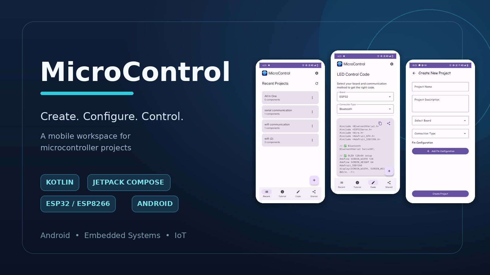
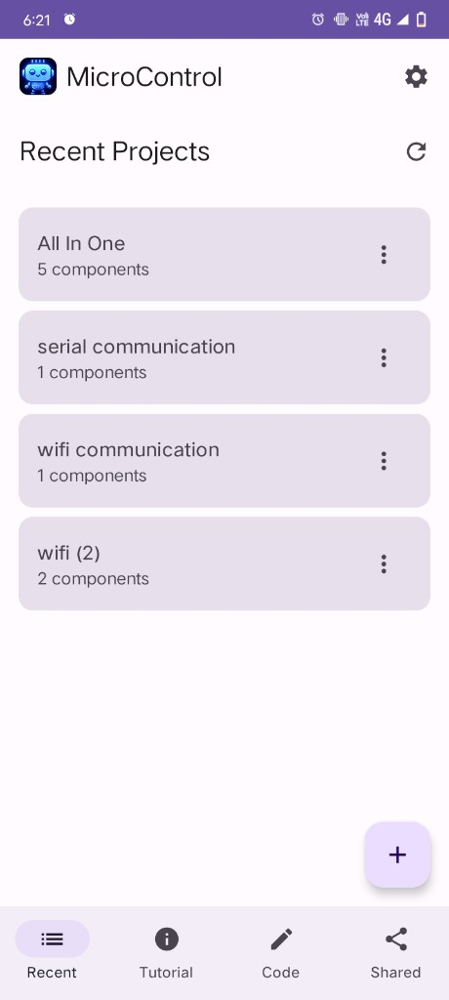
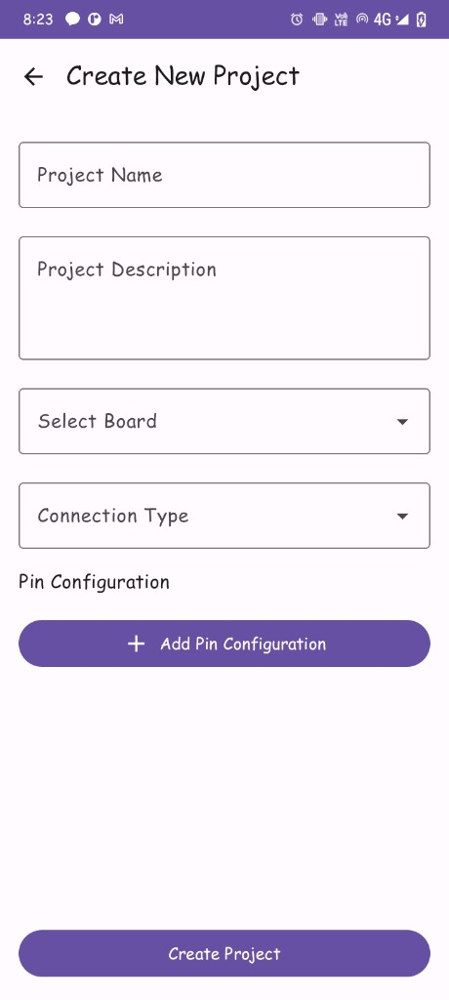
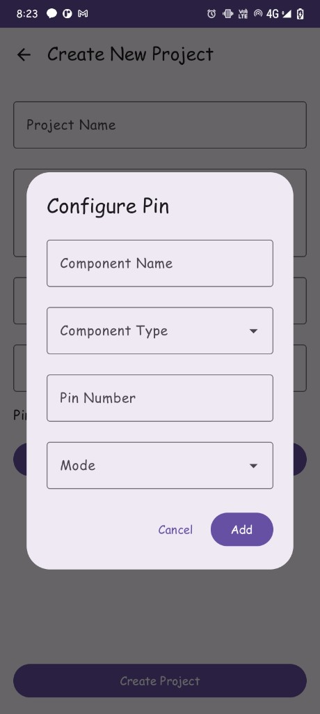
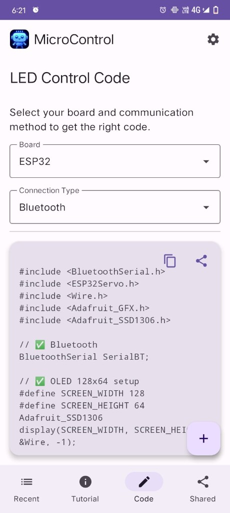
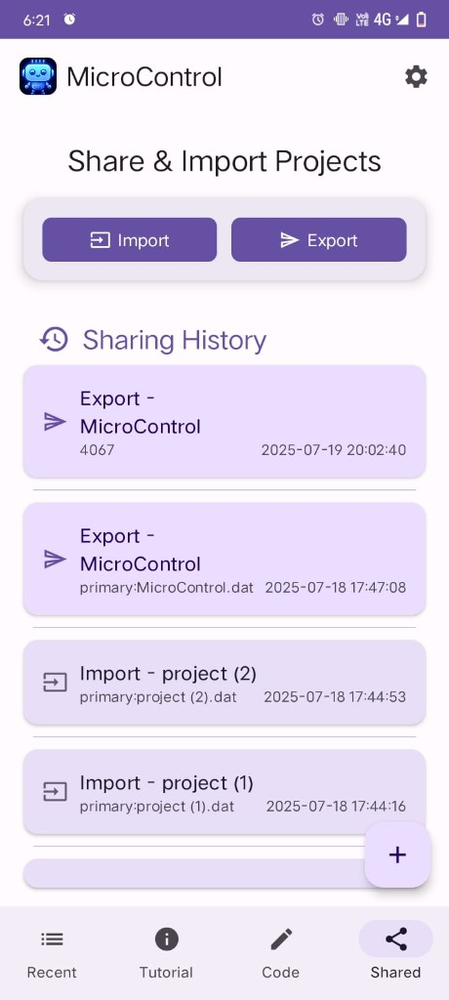
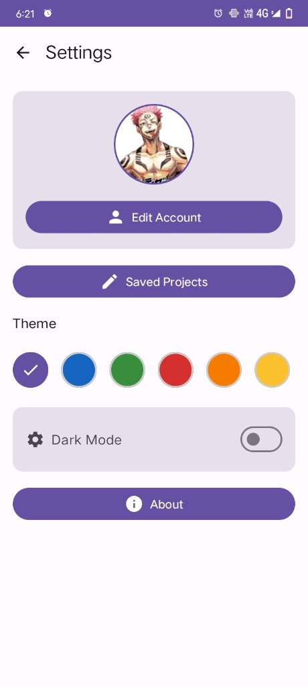

<div align="center">



# MicroControl

**An Android companion app for creating, configuring and controlling microcontroller projects.**


</div>

---

## Overview

MicroControl is an Android application built with **Kotlin and Jetpack Compose**. It brings several parts of a microcontroller workflow into one mobile interface: project configuration, pin/component setup, firmware-template generation, project file management, and a controller interface for supported connection modes.

The project is intended as an educational and portfolio application exploring the connection between Android development, embedded systems and IoT workflows.

## Current capabilities

| Area | Included in the source |
|---|---|
| Project setup | Create projects with a name, description, board selection and connection type |
| Pin configuration | Configure component types, GPIO assignments and control modes |
| Firmware templates | Generate ESP32 Wi-Fi and Bluetooth Classic examples, plus ESP8266 Wi-Fi example sketches |
| Controller UI | Pin control interfaces for Wi-Fi, Bluetooth Classic and USB serial modes |
| Wi-Fi transport | HTTP POST commands to the board's `/control` endpoint |
| Bluetooth transport | Bluetooth Classic Serial Port Profile (SPP) connection flow |
| USB serial | USB OTG serial connection using the USB Serial for Android library |
| Project management | Recent projects, local save, import, export, rename and delete flows |
| Tutorials | In-app walkthroughs for project setup and connection concepts |
| Preferences | Theme selection, dark mode and profile settings |

**Board support note:** the project form contains ESP32, ESP8266, Arduino, STM32 and Raspberry Pi choices, but the code generator currently provides ESP32 Wi-Fi, ESP32 Bluetooth Classic, and ESP8266 Wi-Fi examples. Other board/connection selections may fall back to a generic reference sketch; they are not complete board-specific generators or verified hardware integrations.

**Connection note:** each connection mode requires matching firmware and a compatible physical board. Bluetooth uses Classic SPP, not BLE. USB serial depends on Android USB-host/OTG support and the USB-to-UART interface on the board. Validate each mode with the target hardware before relying on it.

## Screenshots

<table>
  <tr>
    <td align="center"><br><sub>Recent projects</sub></td>
    <td align="center"><br><sub>Create project</sub></td>
    <td align="center"><br><sub>Pin configuration</sub></td>
  </tr>
  <tr>
    <td align="center"><br><sub>Firmware templates</sub></td>
    <td align="center"><br><sub>Import and export</sub></td>
    <td align="center"><br><sub>Settings</sub></td>
  </tr>
</table>

[View the in-app tutorial screenshot](screenshots/02-tutorial.jpg).

## Technology stack

| Layer | Technology |
|---|---|
| Language | Kotlin |
| UI | Jetpack Compose, Material 3 |
| Navigation | Navigation Compose |
| Android lifecycle | AndroidX Lifecycle / ViewModel |
| HTTP | OkHttp |
| Image loading | Coil Compose |
| USB serial | USB Serial for Android |
| Async operations | Kotlin Coroutines |
| Build | Gradle Wrapper, Android Gradle Plugin |

## Architecture at a glance

```text
┌──────────────────────────────────────────────┐
│                MicroControl UI                │
│  Projects • Pin setup • Code • Controller    │
└──────────────────────┬───────────────────────┘
                       │
           ┌───────────┴───────────┐
           │                       │
   Project / Storage         Controller layer
   ViewModel + files          ├─ Wi-Fi / HTTP
                              ├─ Bluetooth Classic SPP
                              └─ USB OTG Serial
                                      │
                                      ▼
                         Compatible microcontroller
                         + matching board firmware
```

## Requirements

- Android Studio with support for the Android Gradle Plugin version used here
- JDK 17
- Android SDK Platform 35
- A physical Android phone for Bluetooth and USB OTG testing
- A compatible ESP32/ESP8266 development board for end-to-end controller tests

The project uses **Android Gradle Plugin 8.10.1**, **Gradle 8.11.1** and **Kotlin 2.2.21**. The wrapper and version catalog are included.

## Build from source

1. Clone the repository.
2. Open the repository root (the folder containing `settings.gradle.kts`) in Android Studio.
3. Install Android SDK Platform 35 if prompted.
4. Allow Gradle sync and dependency resolution.
5. Select an Android device or emulator and run the `app` configuration.

Command line:

**Windows PowerShell / Command Prompt**

```powershell
.\gradlew.bat testDebugUnitTest assembleDebug
```

**macOS / Linux**

```bash
./gradlew testDebugUnitTest assembleDebug
```

The debug APK is generated at:

```text
app/build/outputs/apk/debug/app-debug.apk
```

The repository intentionally does not include the older APK supplied with the original project archive because it predates the current source snapshot. Build a fresh APK from the checked-out source and test it on a device before sharing it.

## Permissions and network behavior

The current manifest requests permissions for internet access, Bluetooth, media/storage access and broad external-file access. The existing storage implementation uses legacy/shared-storage behavior, including `MANAGE_EXTERNAL_STORAGE` on supported Android versions. This is a broad permission and should be redesigned around Android's Storage Access Framework or app-specific storage before any Play Store submission.

The project also permits cleartext HTTP because the generated ESP32 control example communicates with a local board over HTTP. Use this only on a trusted local network. Do not expose the board's control endpoint to the public internet without adding appropriate authentication and transport security.

## Known limitations / validation still required

- End-to-end behavior depends on matching firmware running on the selected microcontroller.
- The generator currently provides ESP32 Wi-Fi, ESP32 Bluetooth Classic and ESP8266 Wi-Fi templates. Other board/connection combinations are not complete generators.
- Validate generated sketches against the exact board core and libraries installed by the user.
- Bluetooth Classic behavior requires an SPP-capable device; BLE peripherals are not supported by this flow.
- USB serial needs a compatible USB OTG host connection, supported USB-UART adapter and Android device permission.
- The current USB permission receiver reports the permission result; reconnect behavior should be exercised on the target Android device.
- Sensor values shown by board firmware are not automatically discovered for every sensor type; board-side firmware must send the expected serial message format.
- The supplied source snapshot has not been rebuilt in this environment. GitHub Actions is configured to run the Android unit tests and debug build on push/pull request.
- The current storage-permission approach is a prototype limitation and should be refactored before production distribution.
- Project records are currently persisted with Java object serialization. Keep the serialized `Project` model compatible across app updates; a versioned JSON/Room migration would be safer for a production app.

See [`docs/VALIDATION.md`](docs/VALIDATION.md) for a concrete test checklist.

## Repository structure

```text
MicroControl/
├── app/
│   ├── src/main/
│   │   ├── java/com/myesp32upgrade/microcontrol/
│   │   │   ├── ui/screens/       # Compose screens
│   │   │   ├── ui/theme/         # Theme and typography
│   │   │   ├── model/            # Project data model
│   │   │   ├── viewmodel/        # Project state and save flow
│   │   │   ├── navigation/       # Navigation routes
│   │   │   └── utils/            # Storage and permissions
│   │   └── res/                  # Android resources
│   └── src/test/                 # Local unit tests
├── screenshots/                 # Genuine app screenshots
├── assets/images/               # README overview artwork
├── docs/                         # Build, architecture and validation notes
├── gradle/                       # Version catalog and wrapper
├── releases/                     # Instructions for creating a fresh build
└── .github/workflows/            # CI build and test workflow
```

## Security and contribution notes

- Never commit signing keystores, passwords, `local.properties`, or personal credentials.
- `keystore.properties.example` is a template only. Keep the real `keystore.properties` local.
- Report bugs with Android version, board, connection type and reproduction steps.
- Keep hardware support claims tied to tests performed on actual devices.

See [`CONTRIBUTING.md`](CONTRIBUTING.md), [`SECURITY.md`](SECURITY.md) and [`docs/GITHUB_PUBLISHING.md`](docs/GITHUB_PUBLISHING.md) for publishing instructions.

## License

This project is released under the MIT License. See [`LICENSE`](LICENSE).

## Author

**Kanakaraju N P**  
Electronics & Communication Engineering | Embedded Systems | IoT | Robotics  
GitHub: [@kanakaraju0121](https://github.com/kanakaraju0121)
